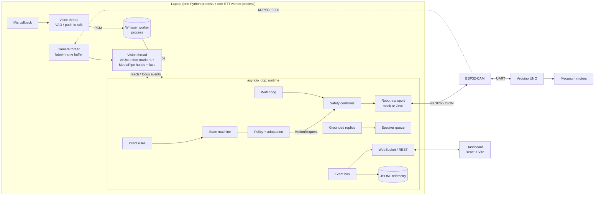

# Architecture



## Planes

- **Control plane** (direct calls, on the event loop): vision/voice → runtime →
  state machine → policy → safety → transport. One thread mutates control state, so there are
  no locks around it.
- **Observability plane** (event bus): every step publishes a typed `Event`
  (`event_id`, `seq`, `timestamp`, `mono`, `event_type`, `source`, `session_id`, `payload`,
  `confidence`, `simulated`). The dashboard, the JSONL log and the debug view read only this.
  Requested, sent, acknowledged and completed are separate events, and the event payloads
  say what each one does and does not prove.

## Modules (`backend/app`)

| Package | Responsibility |
|---|---|
| `runtime.py` | Orchestrator: commands, vision/voice handlers, motion bookkeeping, snapshot, experiments |
| `intelligence/state_machine.py` | 11 states, 18 triggers, explicit transition table with guards and `IGNORE` entries |
| `intelligence/policy.py` | Transparent rules → `Decision` (action, line category, rule trace, motion request) |
| `intelligence/adaptation.py` | History rules A1-A4/U1-U3 adjusting cooldown, strictness, escalation, autonomy |
| `safety/controller.py` | Arming, e-stop latch, profile clamping, autonomy gates, obstacle checks, motion execution |
| `safety/watchdog.py` | Orphan motion, deadline overrun, event-loop stall |
| `robot/` | `RobotTransport` interface, `MockRobotTransport` (kinematics, latency, device watchdog, link loss), `ZeusRobotTransport` (verified protocol) |
| `vision/` | Camera thread, MediaPipe wrappers, zone geometry, robot tracker (ArUco markers → phone zone that follows the robot, [ROBOT_TRACKING.md](ROBOT_TRACKING.md)), reach detector, focus estimator, pipeline with per-stage timings + MJPEG overlay |
| `voice/` | Mic + VAD (with barge-in and echo filtering), Whisper worker, deterministic intents, grounded composer, personality engine + content guard, P0-P3 speech queue, voice router (cached / live Fish Audio, local voice, text only), clip cache and byte budget, optional Claude replies ([VOICE_PERSONALITY.md](VOICE_PERSONALITY.md)) |
| `sessions/` | Timer with pause accounting, progress, metrics from observed signals only |
| `telemetry/` | Event bus with drop-oldest subscribers, JSONL writer, session summaries |
| `simulation/` | Labelled synthetic perception (Mode C) and the scripted demo |
| `api/` | REST commands, WebSocket snapshots/events/audio levels, MJPEG stream |

## Threads and processes

| Thread / process | Work | Hand-off |
|---|---|---|
| asyncio loop | API, state, policy, safety, transports, TTS subprocesses | — |
| camera thread | `cv2.VideoCapture.read()`, mirroring | single-slot condition variable (newest frame wins) |
| vision thread | marker detection, MediaPipe, reach detector, focus estimator, JPEG render | `loop.call_soon_threadsafe` (the robot-moving flag goes the other way under a lock) |
| PortAudio callback + voice thread | mic blocks → VAD or push-to-talk buffer | bounded queue |
| STT thread + **worker process** | whisper.cpp (Metal) or faster-whisper in a spawned process (keeps PyAV's libavdevice out of the OpenCV process on macOS) | multiprocessing pipe |
| **language model worker process** (M5) | Qwen3-4B on MLX: persona KV cache, prompt reuse (only what changed since the last prompt is read), context prefilled while the user talks, streamed generation, cancel; pauses its prefill while Whisper uses the GPU | multiprocessing pipe + reader thread -> asyncio queue; a shared Event for the Whisper pause |
| Kokoro renders (M5) | ONNX Runtime on CPU in `asyncio.to_thread`; one render at a time | returns PCM to the voice router |

## Modes

| Code | Robot | Camera | Label shown |
|---|---|---|---|
| A | Zeus (real) | live | FULL PHYSICAL |
| B | mock | live | LIVE PERCEPTION · SIMULATED ROBOT |
| C | mock | off (synthetic, labelled events) | FULL SIMULATION |

Switching the robot driver is one click (Sim / Zeus) and never restarts the process. Every
simulated event carries `simulated: true` and is tagged SIM in the UI.

## Persistence and privacy

- `data/telemetry/run-*.jsonl`: every non-ephemeral event of a run.
- `data/sessions/<id>.json`: per-session summary with metrics and focus transitions.
- `data/runtime_settings.json`: zone calibration (fixed points, or the zone in each marker's frame
  when it follows the robot) and tuning, written atomically.
- `data/tts_cache/`: pre-rendered robot lines.
- Camera frames and audio stay in memory only. No video or audio is written to disk (the
  `store_raw_video` switch exists but nothing writes video), and nothing is uploaded unless
  the optional LLM / Fish Audio keys are configured (text only; Fish Audio receives the
  text of lines to speak). Only fixed template lines are cached on disk as audio
  (`data/tts_cache/`); lines with session details and LLM replies are not.
- The API binds to 127.0.0.1 only: it can move a robot, so it is not exposed to the hackathon
  network.

## Key interfaces

- REST: `/api/session/*`, `/api/robot/{connect,arm,autonomy,move,stop,return,home}`,
  `/api/release`, `/api/estop`, `/api/reset`, `/api/command` (typed text through the voice
  pipeline), `/api/vision/{start,stop,zone,zone/attach,zone/detach,marker.png,cameras,stream.mjpg}`, `/api/voice/*`,
  `/api/sim/*`, `/api/experiments/*`, `/api/sessions`, `/api/metrics/perf`, `/api/health`.
- WebSocket `/ws`: `snapshot` (on connect, after events, 2 Hz heartbeat), `event`, `audio`,
  `pong`; client sends `ping` and push-to-talk `ptt`.

## Conversation and behaviour (Milestone 5)

```
 mic ─PTT─▶ whisper.cpp worker ─text─▶ runtime._handle_utterance
              ▲                         │ echo / barge-in gates, fail-safe stop on a stop word
   PTT down: companion.speculate()      ▼
   (model reads the context            companion.route ──"reflex"──▶ _dispatch_intent (M4 parser path, cached voice)
    while the user talks)               │ "converse": longer or unrecognised sentences
                                        ▼
            context.render ──▶ local_llm (worker) ──stream──▶ dialogue: validate action head,
            (OBSERVED vs USER SAID,                            check each sentence, release it
             bounds, allowed actions)                          to the voice as soon as it passes
                                        │
                     typed ActionRequest ──▶ companion._execute ──▶ runtime handlers
                                        │                         └─ physical ──▶ SafetyController
                                        ▼
                                Speaker (P2) ──▶ VoiceRouter: Fish cache | Kokoro (local) | macOS voice

 camera/timer/link events ──▶ behaviour engine (decision + rules, recorded) ──▶ companion.react:
                              prepared line (written ahead by the model) | fixed line
```

| Module | Role |
|---|---|
| `intelligence/context.py` | Bounded session memory: 10 turns, 24 observations, 8 statements, goal, quiet mode, complaints. Observations come only from bus events (`companion._on_event`). Nothing is written to disk. |
| `intelligence/prompting.py` | The fixed persona (cached in the worker) and the chat-template split that makes the cache reusable |
| `intelligence/local_llm.py`, `llm_worker.py` | The model process; `prefill` (context read while the user talks), streaming, background requests that yield to people |
| `intelligence/actions.py` | The closed, typed action vocabulary; JSON parsing; incremental extraction of the spoken part while it streams |
| `intelligence/dialogue.py` | One reply per turn: allowed actions, guards (`check_reply`), streaming release, one retry |
| `intelligence/behavior.py` | When to speak unprompted: rule-tagged decisions for possible and confirmed reaches, streaks, camera loss, milestones, essentials |
| `intelligence/companion.py` | Glue: routing, action execution through the runtime's handlers, reactions, anticipation, dashboard snapshot (`state.mind`) |
| `voice/kokoro_tts.py` | Local neural voice; fixed lines cached on disk, generated lines in memory only |
| `voice/input.py` `SileroVAD` | Hands-free speech detection |

Event types added: `behavior.decision`, `action.requested`, `action.resolved`, `dialogue.reply`.
